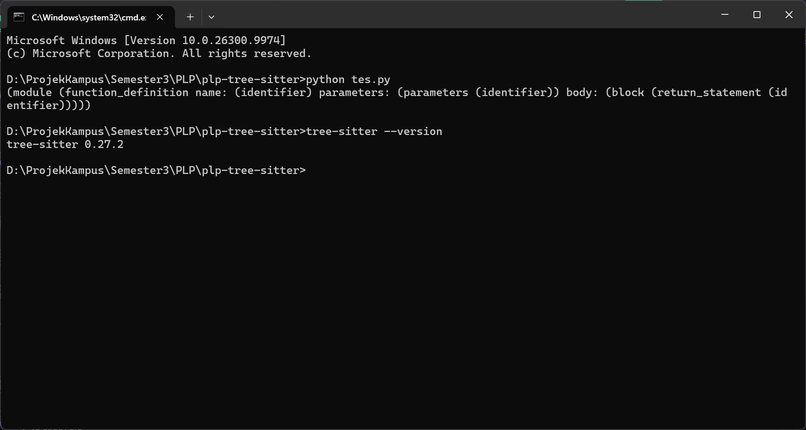
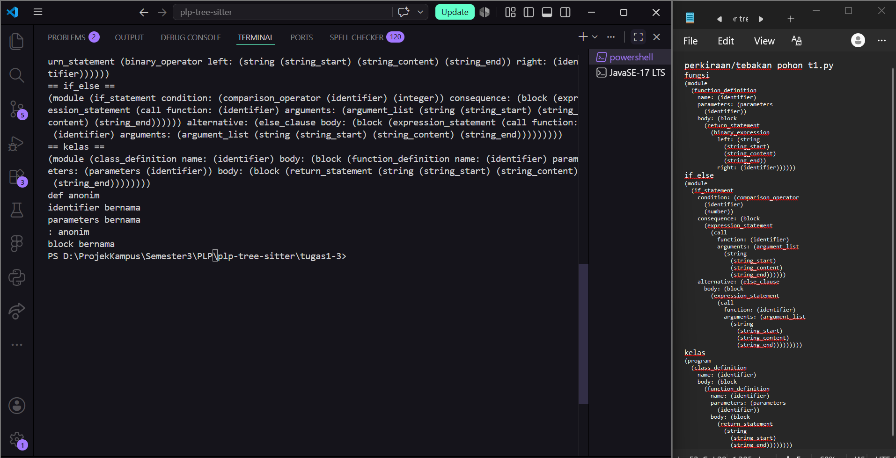
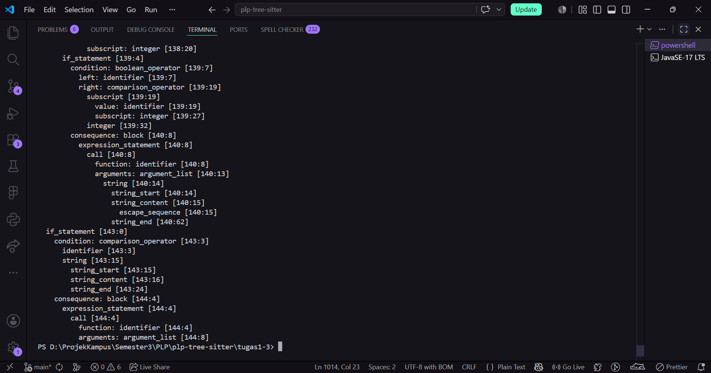
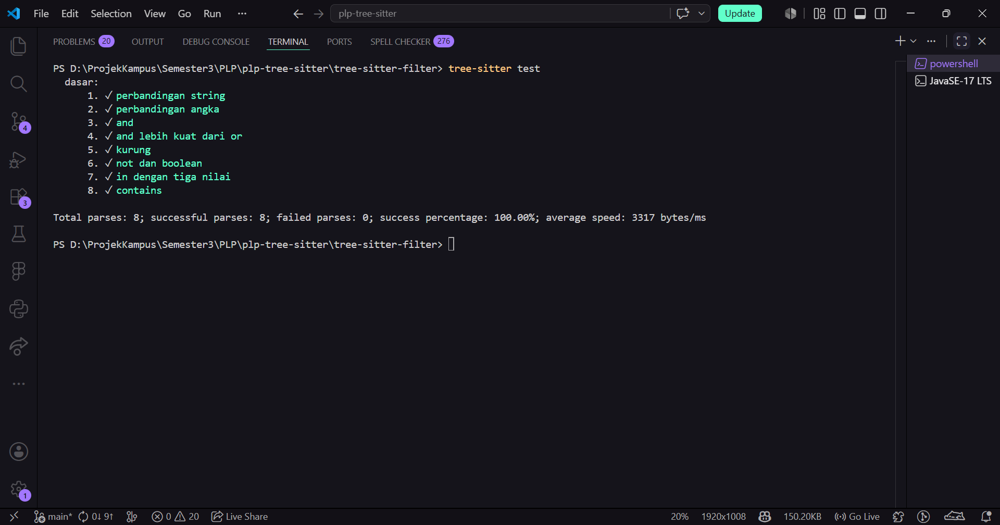
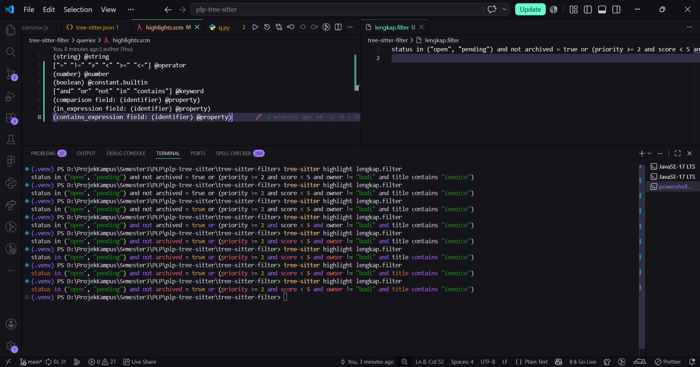
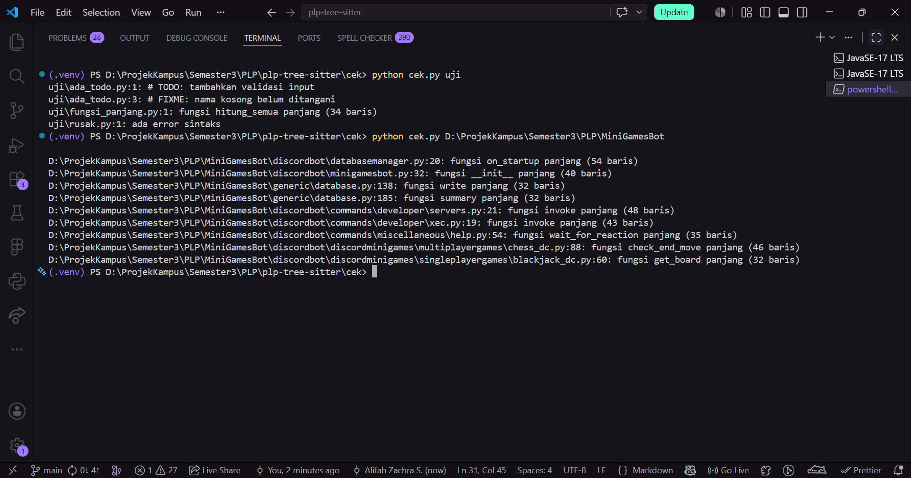

# Laporan Tugas Awal Tree-sitter

**Nama:** Alifah Zachra Syifatunnajwa
**NIM:** 251524036
**Kelas:** 2B-D4
**Mata kuliah:** Programming Language Pragmatics

## Setup

**Lingkungan:** Windows, PowerShell, VS Code, Python 3.12.10, Node v24.18.0, tree-sitter-cli 0.27.2

**Kendala dan cara mengatasi:** script PowerShell diblokir (execution policy), diatasi dengan `Set-ExecutionPolicy -Scope CurrentUser RemoteSigned`.

## Tugas 1: Membaca pohon

**Hasil:**

**Penjelasan singkat:** Pada tugas ini saya memakai tree-sitter untuk mem-parse tiga potongan kode Python, yaitu `fungsi`, `if_else`, dan `kelas`, lalu mencetak struktur tree-nya. Dari penelusuran anak node, saya menemukan beberapa node anonim, yaitu `def` dan `return` pada potongan `fungsi`, serta `if` dan `:` pada potongan `if_else`. Perbedaan `children` dan `named_children` adalah `children` mengambil semua anak node, termasuk yang anonim, sedangkan `named_children` hanya mengambil anak yang bernama. Pada potongan `fungsi`, `children` berisi 5 node (`def`, `identifier`, `parameters`, `return`, `expression_statement`), sedangkan `named_children` hanya berisi 3 node (`identifier`, `parameters`, `expression_statement`).

**Kendala dan solusi:** Kendala pada memperkirakan hasil pohon. Solusinya dengan memahami pada playground tree sitter.

## Tugas 2: Penjelajah node

**Hasil:**

**Penjelasan singkat:** [2-3 kalimat. Cara rekursi jalan dan cara nama field diambil.]

**Kendala dan solusi:** [Isi, atau tulis "tidak ada"]

## Tugas 3: Query pertama

**Hasil:**

**Penjelasan singkat:** [2-3 kalimat. Pola query yang dipakai dan kenapa hasilnya cocok dengan hitungan manual.]

**Kendala dan solusi:** [Isi, atau tulis "tidak ada"]

## Tugas 4: Grammar DSL filter

**Hasil:**

**Penjelasan singkat:** [2-3 kalimat. Fitur yang ditambah bertahap, kenapa `and` lebih kuat dari `or`, serta tes `in` dan `contains`.]

**Kendala dan solusi:** [Isi, atau tulis "tidak ada"]

## Tugas 5: Highlight

**Hasil:**

**Penjelasan singkat:** [2-3 kalimat. Capture apa saja yang dibuat dan untuk token mana.]

**Kendala dan solusi:** [Isi, atau tulis "tidak ada"]

## Tugas 6: cek.py

**Hasil:**

**Penjelasan singkat:** [2-3 kalimat. Tiga fitur yang dibuat, repo yang dipakai untuk uji, dan hasil cek manual 2 file acak.]

**Kendala dan solusi:** [Isi, atau tulis "tidak ada"]

## Catatan penggunaan AI

Isi hanya untuk tugas yang dibantu AI. Kesalahan AI harus benar-benar kamu temukan sendiri, lengkap dengan buktinya.

| Tugas       | Yang diminta ke AI | Kesalahan atau kekurangan hasil AI | Cara membuktikan                  |
| ----------- | ------------------ | ---------------------------------- | --------------------------------- |
| [Tugas ke-] | [isi]              | [isi]                              | [kasus uji / output / cek manual] |
| [Tugas ke-] | [isi]              | [isi]                              | [isi]                             |
| [Tugas ke-] | [isi]              | [isi]                              | [isi]                             |
