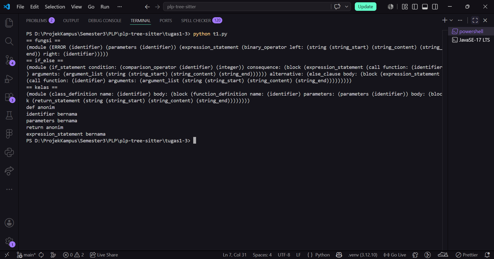
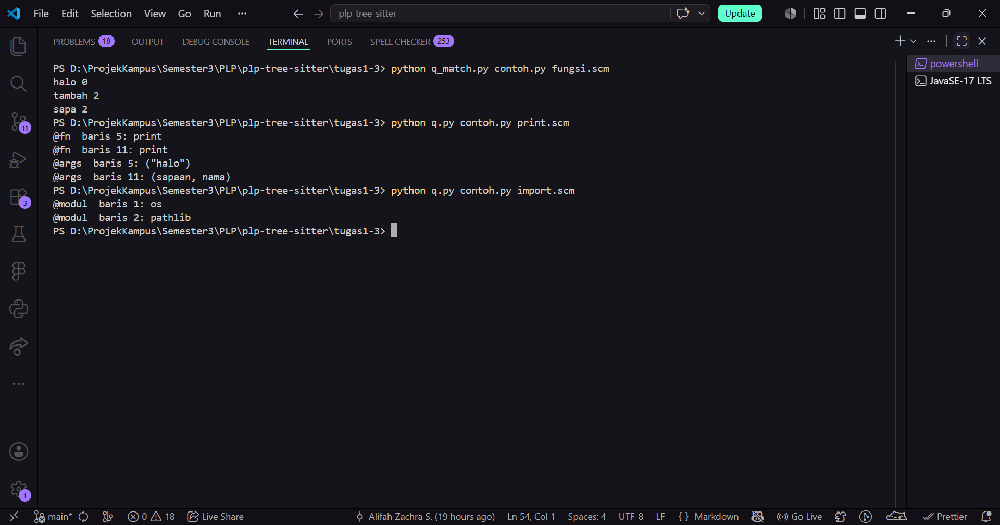
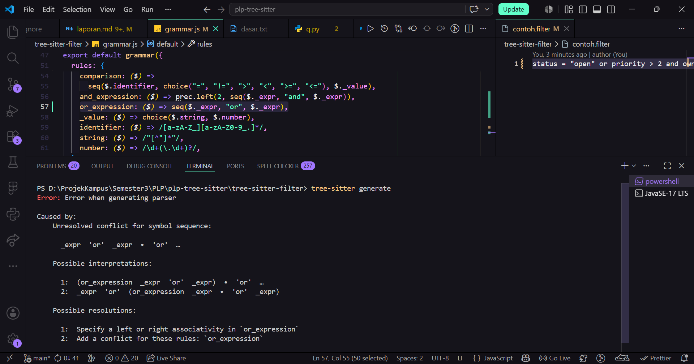
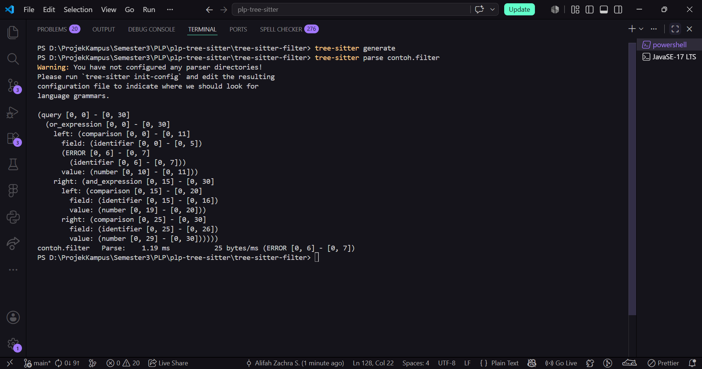
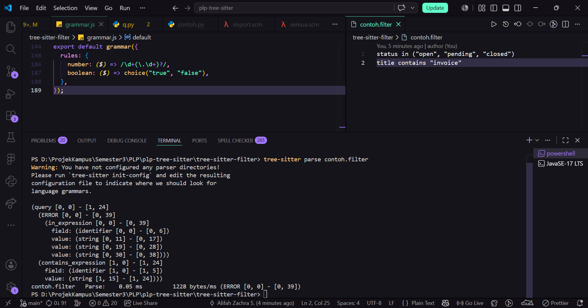

# Laporan Tugas Awal Tree-sitter

**Nama:** Alifah Zachra Syifatunnajwa
**NIM:** 251524036
**Kelas:** 2B-D4
**Mata kuliah:** Programming Language Pragmatics

## Setup

**Lingkungan:** Windows, PowerShell, VS Code, Python 3.12.10, Node v24.18.0, tree-sitter-cli 0.27.2

**Kendala dan cara mengatasi:** script PowerShell diblokir (execution policy), diatasi dengan `Set-ExecutionPolicy -Scope CurrentUser RemoteSigned`.

## Tugas 1: Membaca pohon

**Hasil:**

**Penjelasan singkat:** Pada tugas ini saya memakai tree-sitter untuk mem-parse tiga potongan kode Python, yaitu `fungsi`, `if_else`, dan `kelas`, lalu mencetak struktur tree-nya. Dari penelusuran anak node, saya menemukan beberapa node anonim, yaitu `def` dan `return` pada potongan `fungsi`, serta `if` dan `:` pada potongan `if_else`. Perbedaan `children` dan `named_children` adalah `children` mengambil semua anak node, termasuk yang anonim, sedangkan `named_children` hanya mengambil anak yang bernama. Pada potongan `fungsi`, `children` berisi 5 node (`def`, `identifier`, `parameters`, `return`, `expression_statement`), sedangkan `named_children` hanya berisi 3 node (`identifier`, `parameters`, `expression_statement`).

**Kendala dan solusi:** Kendala pada memperkirakan hasil pohon. Solusinya dengan memahami pada playground tree sitter.

## Tugas 2: Penjelajah node

**Hasil:**

**Penjelasan singkat:** Program ini membaca file Python dari argumen command line, mem-parse isinya dengan tree-sitter, lalu mencetak tree-nya secara rekursif lewat fungsi `jelajah`. Setiap node dicetak dengan indentasi sesuai kedalamannya, diikuti tipe node dan posisinya dalam format `[baris:kolom]`. Nomor baris ditambah 1 karena `start_point` dimulai dari 0. Fungsi ini hanya menelusuri anak yang bernama (`is_named`), sehingga token anonim seperti `def` dan `:` tidak ikut tercetak. Untuk setiap anak, program juga mengambil nama field dari grammar lewat `field_name_for_child`, misalnya `name:`, `parameters:`, dan `body:`, sehingga hubungan antara node induk dan anaknya terlihat jelas.

**Kendala dan solusi:** Fungsi rekursi sempat tidak menampilkan nama field. Solusi memperbaiki indeks child yang digunakan.

## Tugas 3: Query pertama

**Hasil:**

**Hasil query vs hitungan manual:**

| Query | Hasil query | Hitungan manual | Cocok? |
| --- | --- | --- | --- |
| Fungsi dan jumlah parameter | halo 0 (baris 4), tambah 2 (baris 7), sapa 2 (baris 10) | halo 0, tambah 2, sapa 2 | ya |
| Pemanggilan print | 2 pemanggilan, di baris 5 dan baris 11 | 2 pemanggilan | ya |
| Import | os (baris 1), pathlib (baris 2) | os, pathlib | ya |

**Penjelasan singkat:** Tiga query ditulis di file `.scm` dan dijalankan lewat `q.py` yang memakai `QueryCursor`. Query pertama menangkap nama fungsi dan node `parameters`, lalu jumlah parameter dihitung dari `named_child_count`. Query kedua mencari pemanggilan `print` dengan predikat `#eq?`. Query ketiga mengambil nama modul dari `import_statement` dan `import_from_statement`, dengan nama node dicek dulu lewat `jelajah.py`. Hasil ketiganya sama dengan hitungan manual pada `contoh.py`.

**Kendala dan solusi:** Query fungsi dengan `captures` menampilkan nama fungsi dan parameter secara terpisah, sehingga tidak bisa dipasangkan. Solusinya memakai `matches` di `q_match.py` supaya nama dan parameter dalam satu match bisa diambil bersamaan.

## Tugas 4: Grammar DSL filter

**Hasil:**

**Penjelasan singkat:** Grammar filter dikembangkan dengan tiga fitur utama, yaitu operator logika (and, or, not), pengelompokan menggunakan kurung dan boolean, serta operator perbandingan (in, contains) dan label field. Pengujian dilakukan melalui tree-sitter generate, parse, dan test. Hasil pengecekan manual pada dua file acak menunjukkan grammar berhasil mengenali sintaks sesuai aturan yang dibuat.

**Kendala dan solusi:** Kesulitan memahami cara pembuatan grammar per case. Solusi dengan bertanya pada AI

## Tugas 5: Highlight

**Hasil:**

**Penjelasan singkat:** File `queries/highlights.scm` berisi capture untuk tiap jenis token. Kata kunci (`and`, `or`, `not`, `in`, `contains`) diberi `@keyword`, operator perbandingan diberi `@operator`, lalu `string`, `number`, dan `boolean` masing-masing punya capture sendiri. Nama field pada `comparison`, `in_expression`, dan `contains_expression` diberi `@property`. Sebelum query diisi lengkap, konfigurasi CLI dicek dulu lewat satu baris `(string) @string` sampai string berwarna, baru capture lain ditambah satu per satu pada file `lengkap.filter`.

**Kendala dan solusi:** Kesulitan konfigurasi highlight di awal, ada warning karena highlight tidak dikenali. Solusi dengan menambahkan path highlight yang sesuai di tree-sitter.json

## Tugas 6: cek.py

**Hasil:**

**Hasil cek manual (2 file acak dari repo MiniGamesBot):**

| File | Hasil cek.py | Hasil cek manual | Cocok? |
| --- | --- | --- | --- |
| `discordbot\discordminigames\singleplayergames\blackjack_dc.py` | 1 fungsi > 30 baris (`get_board` baris 60, 32 baris), 0 TODO/FIXME, 0 error sintaks | Fungsi `get_board` berada di baris 60–91 (total 32 baris > 30), tidak ada komentar `TODO`/`FIXME`, dan sintaks Python valid | Ya |
| `discordbot\databasemanager.py` | 1 fungsi > 30 baris (`on_startup` baris 20, 54 baris), 0 TODO/FIXME, 0 error sintaks | Fungsi `on_startup` berada di baris 20–73 (total 54 baris > 30), tidak ada komentar `TODO`/`FIXME`, dan sintaks Python valid | Ya |

**Penjelasan singkat:** cek.py menelusuri semua file .py di folder yang diberikan dan melaporkan tiga hal. Pertama komentar TODO dan FIXME, lewat query komentar dengan predikat `#match?`. Kedua fungsi yang body-nya lebih dari 30 baris, dihitung dari `start_point` dan `end_point` node `function_definition`. Ketiga file yang pohonnya punya error, dicek lewat `has_error`, lalu baris pertama yang bermasalah dicari dengan fungsi rekursif. Skrip diuji di folder `uji` buatan sendiri dan di repo MiniGamesBot, lalu dua file acak dicocokkan manual dengan hasil cocok.

**Kendala dan solusi:** Kesulitan memahami instruksi tugas. Solusi dengan bertanya pada AI.

## Catatan penggunaan AI

| Tugas | Yang Diminta ke AI | Kesalahan atau Kekurangan Hasil AI | Cara Membuktikan |
|---|---|---|---|
| Setup | Membantu setup environment | Beberapa instruksi tidak kompatibel | Kasus uji dan output |
| Tugas ke-2 | Menganalisis kesalahan kode rekursi | Hasil terlalu bertele-tele | Output |
| Tugas ke-3 | Menjelaskan SCM dan keterhubungannya dengan Python | Sesuai | Output |
| Tugas ke-4 | Breakdown cara kerja yang tepat di setiap langkah | Urutan cara kerja ada yang kurang tepat | Kasus uji dan output |
| Tugas ke-4 | Langkah membuat grammar sesuai case/langkah | Salah menginterpretasikan input dan output sehingga hasil tidak sesuai | Kasus uji dan output |
| Tugas ke-5 | Menganalisis warning entry point highlight | Sesuai | Output |
| Tugas ke-6 | Menganalisis error module | Sesuai | Output |
| Tugas ke-6 | Menjelaskan dan membantu mengerjakan tugas 6 | Sesuai | Kasus uji dan output |
| Tugas ke-6 | Membuat README cek tugas 6 | Sesuai | Output |
